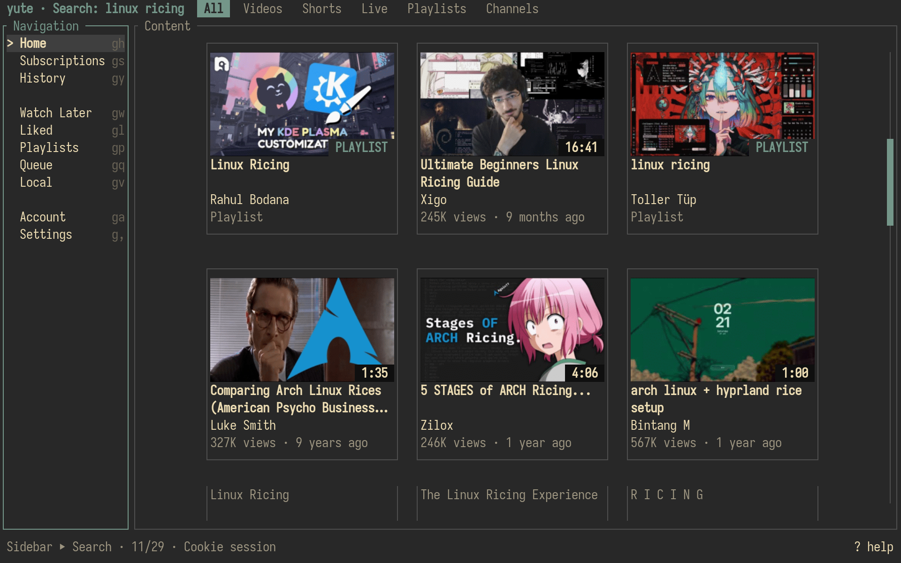
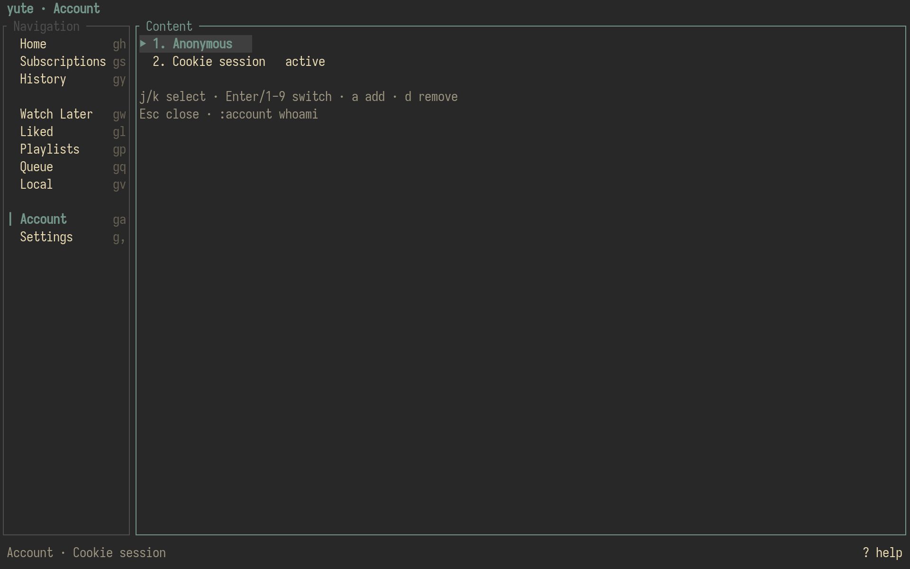

<p align="center">
  
</p>

<h1 align="center">Yute</h1>

<p align="center">
  <strong>A keyboard-first YouTube client for the terminal.</strong><br>
  Browse in the TUI. Play in MPV.
</p>

<p align="center">
  <a href="https://www.rust-lang.org/"></a>
  <a href="LICENSE"></a>
  <a href="https://github.com/kmanisk/yute/stargazers"></a>
  <a href="https://github.com/kmanisk/yute/commits/main"></a>
  
</p>

<p align="center">
  Rust + Ratatui + Tokio · InnerTube browsing · Sixel/Kitty thumbnails · external MPV
</p>


Yute keeps discovery, navigation, account views and queue management inside the terminal while delegating actual video playback to external MPV over Unix JSON IPC. It is designed for keyboard-heavy workflows rather than reproducing `youtube.com` inside a terminal.

## Highlights

- **Keyboard first** — Vim-style movement, `g` navigation, `/` search and a `:` command line.
- **Real YouTube browsing** — Home, Subscriptions, Search, History, Watch Later, Liked videos, playlists and channels where the active session exposes them.
- **Entity-aware routing** — videos, Shorts and playable live streams go to MPV; channels and playlists open inside Yute.
- **Terminal graphics** — asynchronous Sixel and Kitty thumbnails with Unicode halfblock fallback.
- **External MPV** — playback stays in a real media player while Yute remains responsive and browsable.
- **Account-aware feeds** — Anonymous, saved TV OAuth identities and explicit re-login states are isolated cleanly.
- **Command mode** — completion and history expose power-user actions without filling the UI with permanent chrome.
- **No daemon, webview or Electron** — an event-driven terminal client with near-zero idle redraw overhead.

## Screenshots

### Search and content browsing

The content pane uses YouTube-style thumbnail hierarchy while keeping terminal-native navigation and filters.


### Sidebar navigation

The sidebar can be shown when needed and gives fast access to Home, Subscriptions, History, Watch Later, Liked videos, playlists, the queue, local media, accounts and settings.



<table>
  <tr>
    <td width="50%"></td>
    <td width="50%"></td>
  </tr>
  <tr>
    <td align="center"><sub>Keyboard-driven playback, grid, Shorts and cache settings</sub></td>
    <td align="center"><sub>Anonymous and saved account/session selection</sub></td>
  </tr>
</table>

## Install

### Requirements

- Rust / Cargo
- [`mpv`](https://mpv.io/)
- [`yt-dlp`](https://github.com/yt-dlp/yt-dlp)
- optional: `ffmpeg` / `ffprobe` for local-media metadata
- optional: `wl-copy` or `xclip` for clipboard integration

### From GitHub

```sh
cargo install --git https://github.com/kmanisk/yute yute
```

### Arch Linux / CachyOS

```sh
sudo pacman -S mpv yt-dlp
cargo install --git https://github.com/kmanisk/yute yute
```

### Build from source

```sh
git clone https://github.com/kmanisk/yute.git
cd yute
cargo build --release -p yute
install -Dm755 target/release/yute ~/.local/bin/yute
```

`cargo install yute` will become the shortest path after the first crates.io release.

## First run

```sh
yute
```

Guest browsing works without an account. For personalized account-backed views:

```sh
yute login
```

Yute supports YouTube TV/device-code authentication and account/session selection inside the TUI.

Optional MPV helper/profile setup:

```sh
yute setup-mpv
```

Configuration lives under:

```text
~/.config/yute/
```

Legacy `ytui` settings can be imported without overwriting Yute settings. OAuth tokens migrate into the encrypted XDG data store; legacy cookie data is never used as a signed-in account; see [credential storage](docs/credentials.md).

## Keyboard workflow

Normal mode is the default.

```text
          k
          ↑
      h ←   → l
          ↓
          j
```

| Key | Action |
| --- | --- |
| `h/j/k/l` | Move through cards and lists |
| `Enter` | Open the selected entity |
| `Shift-Enter` | Open item actions |
| `/` | Search |
| `:` | Command mode |
| `g` | Navigation prefix |
| `ga` | Accounts |
| `g,` | Settings (`go` remains compatible) |
| `Alt-e` / `b` | Show, focus or hide the sidebar |
| `Tab` | Cycle pane focus |
| `gg` / `G` | First / last item |
| `Ctrl-d` / `Ctrl-u` | Half-page down / up |
| `Shift-J/K` | Next / previous content filter |
| `Shift-H/L` | Back / forward through route history |
| `a` | Add selected video to queue |
| `y` | Copy selected URL |
| `o` | Open selected entity in the browser |
| `?` | Contextual help |
| `Esc` / `q` | Previous route / quit at root |

`Enter` is driven by the selected entity type:

```text
video / Short / live  ──▶ MPV
channel               ──▶ Channel view
playlist              ──▶ Playlist view
```

## Item actions

`Shift-Enter` opens the contextual item menu. Available actions depend on the selected entity.

Typical actions include:

```text
p   play / open
v   browse playlist
o   open in browser
y   copy URL
t   copy title
a   add to queue
s   save to playlist
d   download
x   cancel active download
```

Channels never expose playback actions. Playlist and account writes are only reported as successful when YouTube confirms them.

Downloads use external `yt-dlp`, respect the current quality limit and default to `~/Videos/Yute`. Local media scanning includes that directory.

## Command line

Press `:` from Normal mode.

```text
:search linux racing
:filter videos
:shorts off
:quality 1080p
:quality best
:queue add
:sidebar toggle
:account
:account whoami
:copy url
:open
:settings
:help
:q
```

Commands support completion and history. See [`docs/commands.md`](docs/commands.md) for the full reference.

Use `:play-select` or Shift-Enter → Play / quality to choose real available
video formats; `:audio` opens original audio streams. Playback stays in external
MPV, with no pre-download or conversion. Manual choices apply to one playback.
Run `yute doctor` from your shell for bounded diagnostics without token output.

## Accounts

Open the account picker with `ga` or `:account`.

```text
:account
:account add
:account <name|index|prefix>
:account remove <name>
:account anon
:account whoami
```

TV OAuth is the only authenticated account mechanism. `:account add` (or `:login`)
shows an activation URL, code, QR and expiry countdown; Esc cancels. Legacy
cookie-only profiles require TV-code re-login. Status shows Anonymous,
OAuth, or Needs re-login. yt-dlp extraction and downloads do not receive cookies
or OAuth credentials. Account-library errors remain visible and are never
replaced with an empty yt-dlp fallback.

The picker can contain Anonymous plus saved account identities. Returned brand profiles use their page-id header when available. Feed caches are isolated per account; thumbnail caches are shared.

Set this if Yute should always start anonymously instead of restoring the last used account:

```toml
[general]
start_anonymous = true
```

## Configuration

```text
~/.config/yute/config.toml
```

Example:

```toml
[general]
icons = "auto"           # auto | nerd | unicode | ascii | none

[content]
shorts = "never"          # never | hide | show

[grid]
columns = 0               # automatic; fixed 1–8 also supported
min_card_width = 30
sidebar_expanded = false

[playback]
max_resolution = "1080p" # 480p | 720p | 1080p | 1440p | 2160p | best
hwdec = "auto-safe"
stream_cache_seconds = 20
use_user_mpv_config = false
osd_bar = false
autoplay = true

[thumbnails]
cache_mb = 256
prefetch_pages = 1
```

Shorts modes:

- `never` — hide Shorts outside explicit Shorts filters/tabs, including saved feeds and suggestions
- `hide` — hide them in ordinary feeds but allow explicit Shorts/saved content
- `show` — show normally

Visible thumbnails take priority over prefetch work. The cache stores source images and encoded terminal payloads.

## Architecture

```text
YouTube / InnerTube
        │
        ▼
┌────────────────────────────┐
│            yute            │
│                            │
│  Home       Subscriptions  │
│  Search     History        │
│  Channels   Playlists      │
│  Queue      Local media    │
└─────────────┬──────────────┘
              │ Unix JSON IPC
              ▼
             MPV
```

Workspace layout:

```text
crates/
├── yute-core   headless YouTube, data and playback logic
├── yute        Ratatui terminal client
└── yute-gui    optional GTK frontend
```

Rendering does not decide what an item does. Content is routed through typed actions before reaching navigation or the player:

```text
ContentItem ──▶ Action ──▶ Router / Player
                    │
                    ├── OpenChannel
                    ├── OpenPlaylist
                    └── Play
```

### Documentation

- [Architecture](docs/architecture.md)
- [Commands](docs/commands.md)
- [Credential storage](docs/credentials.md)
- [MPV tuning](docs/mpv-tuning.md)
- [Performance measurements](docs/performance.md)
- [SmartTube protocol notes](docs/smarttube-parity.md)
- [UI verification](docs/ui-polish-review.md)

## Development

```sh
cargo fmt --check
cargo clippy --workspace --all-targets --all-features
cargo test --workspace
cargo build --release
```

Automatic grid mode fills the content width with 1–8 columns and two-cell gaps.
Settings offers Auto and fixed 1–8 columns. Resize preserves selected content.
Nerd glyphs use verified semantic mappings; auto conservatively uses Unicode
unless `YUTE_NERD_FONT=1` is set. Use `nerd` explicitly with a supported font.
See [configuration](docs/configuration.md), [icon verification](docs/icons.md),
and the [manual QA checklist](docs/qa.md).

## Current limitations

Yute is still early software. Known incomplete areas include:

- full cross-client history/resume parity
- endless Mix-radio continuation
- some authenticated mutations when YouTube does not return usable action parameters

Mix playback currently uses the returned batch. If YouTube does not expose a working account action, Yute reports the limitation instead of pretending the write succeeded.

## License

MIT — see [LICENSE](LICENSE).

