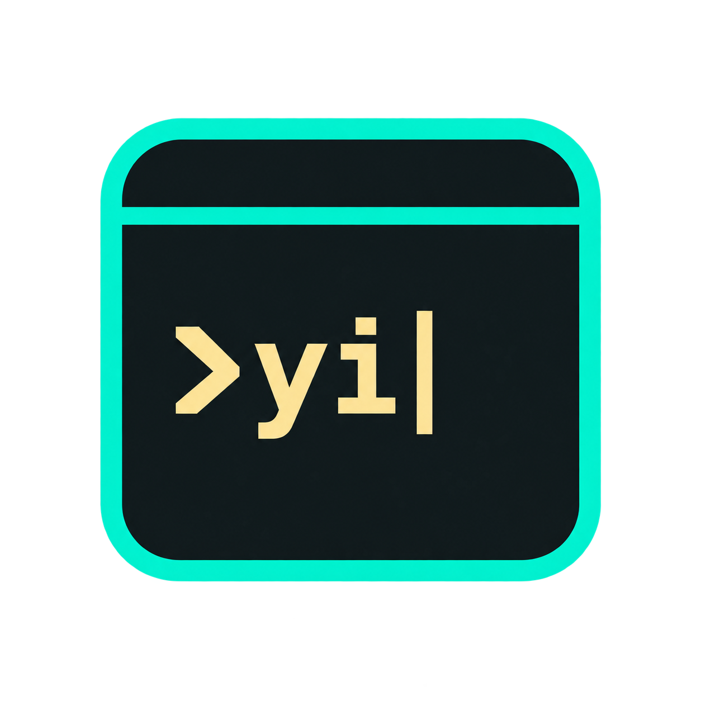
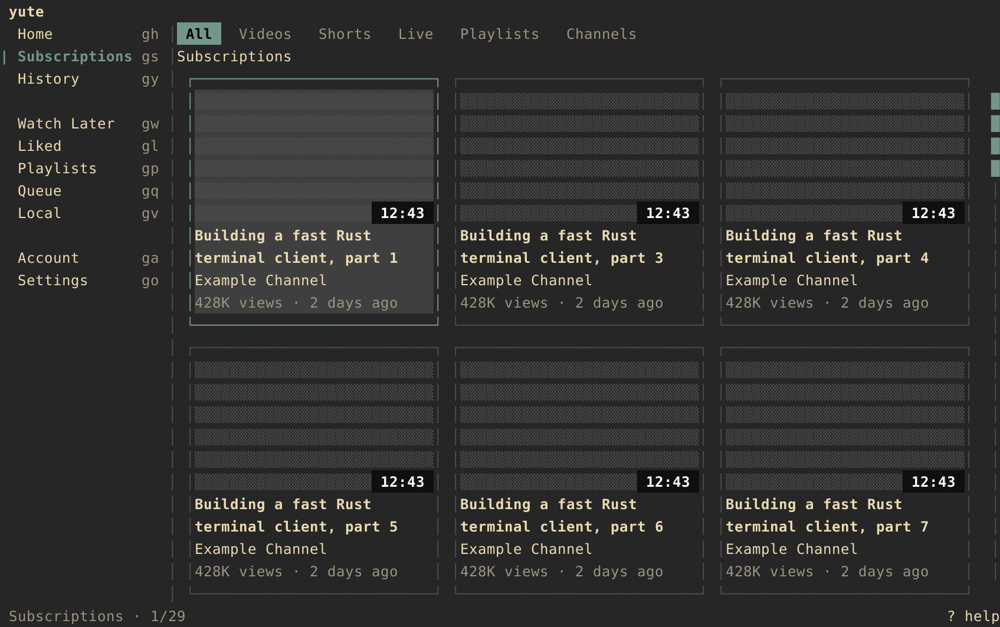
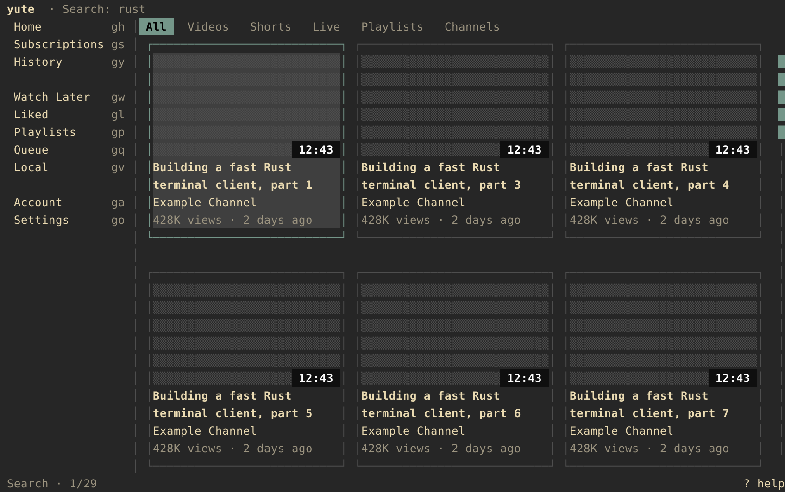
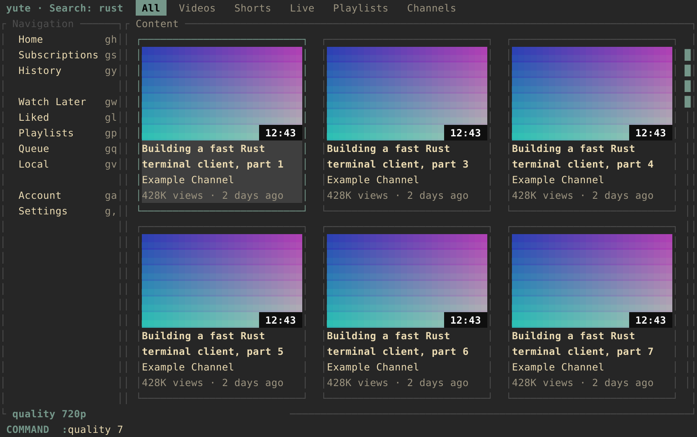
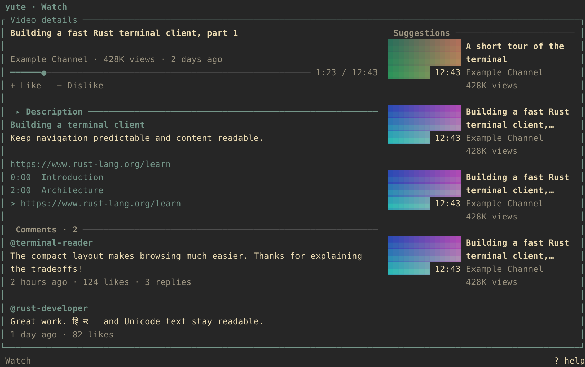
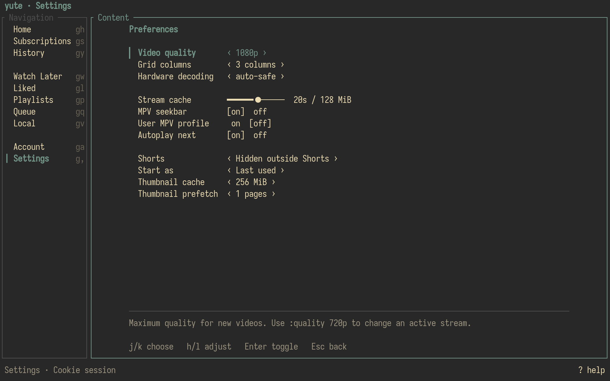
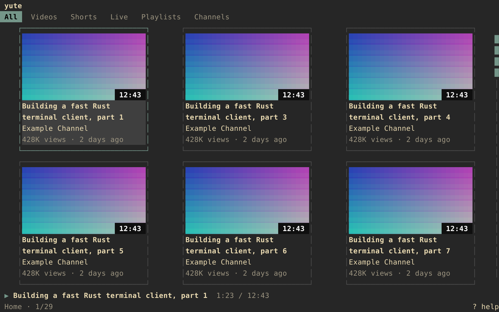

# yute

<p align="center">
  
</p>

<p align="center">
  <strong>YouTube, treated like a terminal application.</strong>
</p>

<p align="center">
  A keyboard-first YouTube client written in Rust with Ratatui and Tokio.<br>
  Discovery stays in the terminal; video playback stays in external MPV.
</p>

<p align="center">
  <a href="https://www.rust-lang.org/"></a>
  <a href="LICENSE"></a>
  <a href="https://github.com/kmanisk/yute/stargazers"></a>
  <a href="https://github.com/kmanisk/yute/commits/main"></a>
  
</p>



---

## Why I built it this way

I wanted a YouTube client that fits the same workflow as Neovim, tmux, yazi and other terminal tools: open it instantly, keep my hands on the keyboard, find something, play it, and keep moving.

That led to a few deliberate choices:

- **the terminal is for browsing, not pretending to be a video player** — Yute sends playback to MPV
- **keyboard first** — Vim-style movement, `g` navigation, `/` search and a `:` command line
- **no permanent service** — no daemon or background watcher just to browse YouTube
- **no embedded browser** — no Chromium, Electron or webview hidden behind a TUI
- **real terminal graphics** — Sixel and Kitty when available, halfblocks everywhere else
- **minimal chrome** — content gets the space; help and actions appear when needed
- **typed navigation** — a channel opens as a channel, a playlist as a playlist, playable media goes to MPV

The goal is not to recreate `youtube.com` cell-for-cell.

The goal is to make YouTube feel native to a keyboard-driven terminal workflow.

---

## What Yute does

```text
YouTube / InnerTube
        │
        ▼
┌────────────────────────────┐
│            yute            │
│                            │
│  Home       Subscriptions  │
│  Search     History        │
│  Channels   Playlists      │
│  Queue      Local media    │
└─────────────┬──────────────┘
              │ Unix JSON IPC
              ▼
             MPV
```

| Part | Yute's choice |
| --- | --- |
| UI | Ratatui + Crossterm |
| Input | Vim-style navigation + command mode |
| YouTube data | InnerTube, with `yt-dlp` as resolver/fallback |
| Images | Sixel / Kitty graphics / halfblocks |
| Playback | external MPV |
| MPV control | Unix-domain JSON IPC |
| Async runtime | Tokio |
| Background service | none |

---

## Features

- **Personalized browsing** — Home recommendations, Subscriptions, Search, History, Watch Later, Liked videos and playlists where the authenticated session exposes them.
- **Entity-aware navigation** — videos, Shorts and live streams play in MPV; channels and playlists stay inside Yute.
- **Terminal thumbnails** — asynchronous image loading with Sixel, Kitty graphics and Unicode halfblock fallback.
- **Keep browsing while video plays** — leaving Watch does not kill the MPV session.
- **Command mode** — Vim-like `:` commands with completion and history.
- **Route history** — move into a channel or playlist and return to the same search/feed position.
- **Queue and local media** — keep a playback queue and browse configured local video directories.
- **Playback tuning** — resolution limits, hardware decoding, stream buffering, autoplay and optional user MPV config.
- **Low idle overhead** — event-driven UI with no animation/redraw loop when nothing changes.

---

## A terminal workflow, not a website clone

<table>
  <tr>
    <td></td>
    <td></td>
  </tr>
  <tr>
    <td align="center"><sub>Search, mixed entities and keyboard navigation</sub></td>
    <td align="center"><sub>Commands live in the bottom line</sub></td>
  </tr>
  <tr>
    <td></td>
    <td></td>
  </tr>
  <tr>
    <td align="center"><sub>Details stay in Yute; playback stays in MPV</sub></td>
    <td align="center"><sub>Settings stay keyboard-driven too</sub></td>
  </tr>
</table>

Playback remains visible as lightweight state while you browse:



---

## Install

### Requirements

- Rust / Cargo
- [`mpv`](https://mpv.io/)
- [`yt-dlp`](https://github.com/yt-dlp/yt-dlp)
- optional: `ffmpeg` / `ffprobe` for local-media metadata
- optional: `wl-copy` or `xclip` for clipboard integration

### From GitHub

```sh
cargo install --git https://github.com/kmanisk/yute yute
```

### Arch Linux / CachyOS

```sh
sudo pacman -S mpv yt-dlp
cargo install --git https://github.com/kmanisk/yute yute
```

### Build it

```sh
git clone https://github.com/kmanisk/yute.git
cd yute
cargo build --release -p yute
install -Dm755 target/release/yute ~/.local/bin/yute
```

`cargo install yute` will become the shortest path after the first crates.io release.

---

## First run

```sh
yute
```

Yute can browse as a guest. For personalized account-backed views:

```sh
yute login
```

This uses YouTube TV/device-code authentication.

Optional MPV helper/profile setup:

```sh
yute setup-mpv
```

Config lives at:

```text
~/.config/yute/
```

Legacy `ytui` settings are imported without overwriting Yute settings. Tokens and cookies migrate into the encrypted XDG data store; see [credential storage](docs/credentials.md).

---

## Keyboard

Normal mode is the default.

```text
          k
          ↑
      h ←   → l
          ↓
          j
```

| Key | Action |
| --- | --- |
| `h/j/k/l` | Move through cards and lists |
| `Enter` | Open the selected entity |
| `Shift-Enter` | Item actions: play, copy, queue, save, download |
| `o` | Open the selected entity in the browser |
| `g,` | Settings (`go` remains compatible) |
| `Alt-e` | Show/focus sidebar; press again to hide |
| `gg` / `G` | First / last item |
| `Ctrl-d` / `Ctrl-u` | Half-page down / up |
| `Shift-J/K` | Next / previous content filter |
| `Shift-H/L` | Back / forward through route history |
| `/` | Search |
| `:` | Command mode |
| `g` | Navigation prefix; delayed hints show destinations |
| `a` | Add selected video to queue |
| `y` | Copy selected URL |
| `b` | Toggle sidebar |
| `?` | Contextual help |
| `Esc` / `q` | Previous route / quit |

`Enter` is based on the selected entity, not the card that happened to render it:

```text
video / Short / live  ──▶ MPV
channel               ──▶ Channel view
playlist              ──▶ Playlist view
```

---

## Command line

Press `:` from Normal mode.

```text
:search rust programming
:filter videos
:shorts off
:quality 1080p
:quality best
:queue add
:sidebar toggle
:copy url
:open
:settings
:help
:q
```

Commands support completion and history, so the command line can expose power-user actions without filling the main UI with permanent controls.

See [`docs/commands.md`](docs/commands.md) for the complete command reference.

---

## Configuration

```text
~/.config/yute/config.toml
```

```toml
[content]
shorts = "never"          # never | hide | show

[grid]
columns = 3               # 0 = automatic
min_card_width = 26
sidebar_expanded = false

[playback]
max_resolution = "1080p" # 480p | 720p | 1080p | 1440p | 2160p | best
hwdec = "auto-safe"
stream_cache_seconds = 20
use_user_mpv_config = false
osd_bar = false
autoplay = true
```

Shorts behavior:

- `never` — hide Shorts outside explicit Shorts filters/tabs, including saved feeds and suggestions
- `hide` — hide them in ordinary feeds but allow explicit Shorts/saved content
- `show` — show normally

Filtering happens at the view layer; the underlying data remains cached.

---

## Architecture

```text
crates/
├── yute-core   headless YouTube, data and playback logic
├── yute        Ratatui terminal client
└── yute-gui    optional GTK frontend
```

The core and TUI are deliberately separated. Rendering does not decide what an item does, and MPV is not embedded into the terminal renderer.

```text
ContentItem ──▶ Action ──▶ Router / Player
                    │
                    ├── OpenChannel
                    ├── OpenPlaylist
                    └── Play
```

That separation is what prevents a channel result from accidentally being treated as a video just because both appear in the same grid.

### Docs

- [Architecture](docs/architecture.md)
- [Commands](docs/commands.md)
- [MPV tuning](docs/mpv-tuning.md)
- [SmartTube protocol notes](docs/smarttube-parity.md)
- [UI verification](docs/ui-polish-review.md)

---

## Development

```sh
cargo fmt --check
cargo clippy --workspace --all-targets --all-features
cargo test --workspace
cargo build --release
```

---

## Still in progress

Yute is early software. The parts I would rather mark incomplete than fake are:

- full cross-client history/resume parity
- endless Mix-radio continuation
- some authenticated mutations when YouTube does not return usable action parameters

Mix playback currently uses the returned batch.

If YouTube does not expose a working account action, Yute reports that limitation instead of pretending the write succeeded.

---

## License

MIT — see [LICENSE](LICENSE).


## Item actions and focus

The route label and result filters share the top row. Navigation and content have
separate frames: the keyboard-focused pane uses the accent border, while the
active sidebar route keeps its marker. Tab cycles pane focus; Alt+E shows/focuses
or hides navigation. Card gutters are two terminal columns, with no large empty
column slots when navigation is hidden.

Shift+Enter opens an item menu. j/k or arrows select, Enter runs the action, and
Esc/q closes the menu. Menu shortcuts are p play/open, v browse playlist, o browser,
y copy link, t copy title, a queue, s save video to playlist, d download, and x
cancel a running download. Options depend on entity type; channels never offer
playback. Ordinary Enter still opens normal playlists internally.

Saving requests the account's actual available playlist destinations, excluding
already-saved entries, and waits for YouTube to confirm the edit. A valid YouTube
session is required; no success is simulated when the endpoint is unavailable.

Downloads use an external yt-dlp process at the current quality limit and write
to `~/Videos/Yute`, which Local also scans. Node support is enabled alongside
any default yt-dlp runtime. Only one job runs at a time; cancel it from the menu.
Exiting Yute terminates an unfinished download; yt-dlp partial files can resume
on a later attempt. Playlist/Mix downloads use their collection URL. No shell is
used to execute entity URLs or filenames. Account cookies are only supplied for
non-guest sessions with an existing cookie file.

Account switching is available through `:account` (`:acc`, `:a`) or `ga`.
The picker includes Anonymous and saved TV identities; returned brand profiles
use their page-id header. Use `:account add`, `:account <name|index|prefix>`,
`:account remove <name>`, `:account anon`, or `:account whoami`.
Set `[general] start_anonymous = true` to start anonymously instead of restoring
the last used account. Cached feeds are isolated by account; thumbnails are shared.
